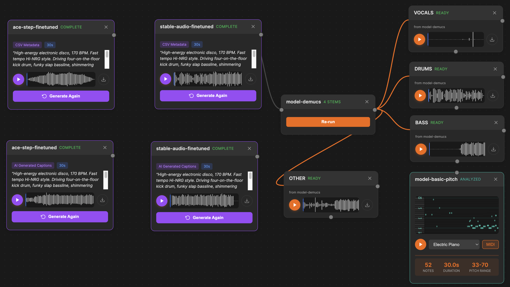

# brAIn: Music Generation Pipeline

Companion repository for *"Messing with Metadata: Finetuning an Open-Source Model on an Advertising Composer's Corpus"*.

## Overview

This repository contains the code and tools used to finetune open-source music generation models (MusicGen, Stable Audio Open) on a personal ~940-track advertising music corpus, comparing how different metadata conditioning approaches affect generation quality:

- **Industry Tags** — standard genre/mood/instrumentation tags from production music metadata
- **Human Captions** — free-form descriptions written by music professionals
- **AI Descriptions** — machine-generated captions from audio analysis models

The node canvas UI provides a visual pipeline interface where audio sources connect to generator and analyzer nodes, enabling interactive exploration of model outputs.


*The node canvas showing multiple generation models (Ace Studio, Stable Audio Open) conditioned on CSV metadata, alongside source separation (Demucs) and pitch analysis (Basic Pitch). Nodes connect visually and process audio through the pipeline.*

## Repository Structure

```
web/                        # Node canvas UI
├── index.html              # Visual pipeline interface
├── backend.js              # Pluggable inference backend (mock + SageMaker)
└── config.json             # Backend configuration

training/                   # Finetuning scripts
├── stable_audio_ft.py      # Stable Audio Open finetuning
├── prepare_dataset.py      # Dataset preparation
├── data_utils.py           # Caption generation utilities
├── configs/                # Model and dataset configurations
│   ├── prompt_loading.py           # Active prompt loader
│   ├── prompt_loading_csv.py       # CSV metadata approach
│   ├── prompt_loading_desc.py      # Description files approach
│   ├── prompt_loading_ai.py        # AI captions approach
│   ├── model_config.json           # Model architecture config
│   └── dataset_config.json         # Dataset paths config
├── scripts/
│   ├── generate_captions.py        # Caption generation script
│   └── metadata_to_jsonl.py        # Metadata conversion
├── sample_data/                    # Anonymized sample data
│   ├── metadata_sample.csv
│   ├── sample_caption.txt
│   └── sample_description.txt
└── requirements.txt

listening-test/             # Listening test for paper evaluation
├── index.html              # Audio comparison player (GitHub Pages)
├── stable-audio/           # Stable Audio Open samples (4 tracks)
└── ace-studio/             # Ace Studio samples (2 tracks)
```

## Running the UI

The node canvas runs as a static web page with a mock backend for demonstration:

```bash
python -m http.server 8000 -d web/
# Visit http://localhost:8000
```

### Backend Modes

- **Mock** (default): Simulated inference with placeholder results. No credentials required.
- **SageMaker**: Real inference via API Gateway + WebSocket. Requires AWS credentials and deployed endpoints.

Set the backend mode in `web/config.json`.

## Node Types

- **Source** — Load or record audio input
- **Generator** — Generate music using finetuned models (MusicGen, Stable Audio Open)
- **Analyzer** — Analyze audio with captioning models (Audio Flamingo)

Nodes connect visually on a canvas. "Run All" executes the full pipeline from sources through generators and analyzers.

## Training Scripts

| Script | Purpose |
|--------|---------|
| `stable_audio_ft.py` | Finetune Stable Audio Open with LoRA on a custom corpus |
| `prepare_dataset.py` | Prepare and validate training datasets |
| `data_utils.py` | Utilities for loading audio and generating captions |
| `generate_captions.py` | Generate AI captions for audio files using LLMs |
| `metadata_to_jsonl.py` | Convert CSV metadata to JSONL training format |

### Metadata Conditioning Configs

The `configs/prompt_loading_*.py` files implement different metadata conditioning strategies:

- `prompt_loading_csv.py` — Loads structured tags from CSV metadata
- `prompt_loading_desc.py` — Loads human-written description files
- `prompt_loading_ai.py` — Loads AI-generated captions

Switch between them by copying to `prompt_loading.py` or modifying the import in the training script.

## Listening Test

Open `listening-test/index.html` in a browser to compare model outputs across metadata conditioning approaches. Each track presents:

- Original reference audio
- Finetuned model output (per metadata type)
- Base model output (per metadata type)

## License

MIT
